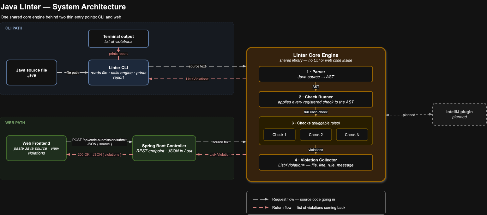

<div align="center">

# Linter

A Java source-code linter developed for the **CS408** project at the **University of Strathclyde**.<br>
It uses **JavaParser** to analyse Java code and report rule violations.

[](https://github.com/MoRayyan107/linter-CS408/actions/workflows/ci.yml)
[](https://github.com/MoRayyan107/linter-CS408/actions/workflows/codeql.yml)


</div>

---

## Current status

The core engine detects **empty catch blocks**, and the CLI analyses individual Java files. Findings include a **rule ID**, **message**, **severity**, **source position**, and **suggested fix**. Catch parameters named `ignore` or `ignored` (case-insensitive) are treated as intentionally ignored.

> The web frontend and backend are initial scaffolds and are not yet connected to the analysis engine. IntelliJ IDEA integration is planned.

---

## Tech stack

| Layer | Technology |
| :--- | :--- |
| Language | Java 21 (Temurin in CI) |
| Build | Maven multi-module, Spotless (google-java-format 1.17) |
| Parsing | JavaParser + JavaSymbolSolver 3.28.2 |
| Core | Lombok, SLF4J |
| Testing | JUnit Jupiter 6.1.3 |
| Backend | Spring Boot 4.1.2 (Web MVC, Validation) |
| Frontend | React 19, Vite 8, Oxlint, Node.js 22 |
| CI / Security | GitHub Actions, CodeQL, Dependabot |

---

## Project structure

| Directory | Purpose | Documentation |
| :--- | :--- | :--- |
| `linter-core/` | Parsing, lint rules, and violation reporting | [Core README](linter-core/README.md) |
| `linter-cli/` | Command-line interface | [CLI README](linter-cli/README.md) |
| `linter-web/backend/` | Spring Boot application scaffold | [Backend README](linter-web/backend/README.md) |
| `linter-web/frontend/` | React and Vite frontend scaffold | [Frontend README](linter-web/frontend/README.md) |
| `plugin/` | Planned IntelliJ IDEA integration | [Plugin README](plugin/README.md) |
| `.github/` | CI, CodeQL, and Dependabot configuration | [Workflows](.github/workflows) |

---

## Project Architecture

<p align="center">
  
</p>

---

## Requirements

- **JDK 21**, matching the Java version used in CI.
- **Maven** available as `mvn`.
- **Node.js 22** and **npm** for frontend development, matching CI.

---

## Getting started

Run commands from the repository root unless stated otherwise.

### Build and check the Java modules

```bash
mvn clean verify
```

This builds the core, CLI, and backend, runs their tests, and checks Java formatting with **Spotless**. It does not build the frontend.

### Run the CLI

First install the Java modules locally so Maven can resolve the CLI's core dependency:

```bash
mvn clean install
```

Then analyse an existing Java source file:

```bash
mvn -pl linter-cli exec:java "-Dexec.mainClass=cli.LinterCli" "-Dexec.args='linter-web/backend/src/main/java/com/cs408/linter/LinterApplication.java'"
```

Replace the example path with a readable `.java` file. The CLI prints the list of detected violations.

> Parsing problems are printed separately to standard error, so an empty list alone does not prove that the input was valid.

### Start the frontend

```bash
cd linter-web/frontend
npm ci
npm run dev
```

Open the local URL printed by Vite.

> The current page is a scaffold, not a working web-based linter.

---

## Development commands

| Command | Working directory | Purpose |
| :--- | :--- | :--- |
| `mvn test` | Repository root | Run Java tests; also checks formatting during compilation |
| `mvn spotless:check` | Repository root | Check Java formatting without changing files |
| `mvn spotless:apply` | Repository root | Apply Java formatting |
| `mvn clean verify` | Repository root | Build, test, and check formatting |
| `npm run lint` | `linter-web/frontend` | Run Oxlint |
| `npm run build` | `linter-web/frontend` | Build the production frontend |
| `npm run preview` | `linter-web/frontend` | Preview an existing production build locally |

> Run `npm ci` in the frontend directory before its npm commands. There is no frontend test script configured yet.

---

## Automated checks

The [CI workflow](.github/workflows/ci.yml) provides three separate checks:

| Check | Purpose |
| :--- | :--- |
| **Java build, tests and formatting** | Catch compilation failures, test regressions, and formatting differences |
| **Frontend lint** | Detect issues reported by Oxlint |
| **Frontend build** | Check that Vite can produce a production build |

Java test reports are uploaded when available, including after failed tests, and retained for **14 days**. Each CI job has a **15-minute** timeout. New runs cancel outdated runs for the same branch or pull request.

The [CodeQL workflow](.github/workflows/codeql.yml) adds separate Java and JavaScript/TypeScript security scans. These look for potential security flaws through static analysis; they complement tests and do not guarantee security. Java is compiled during analysis to account for generated code such as Lombok's. CodeQL jobs have a **30-minute** timeout.

Both workflows are configured for pushes to `main`, `master`, and `dev/**`, and pull requests targeting `main` or `master`. CodeQL also runs weekly on **Monday at 07:23 UTC** and supports manual runs. Check GitHub Actions for actual run results.

---

## Dependency updates

[Dependabot](.github/dependabot.yml) is configured to check Maven dependencies **weekly**, with up to **five** open update pull requests. Each proposed update has its own branch so it can be reviewed and checked by CI before merging. The current configuration does not include npm or GitHub Actions version updates.

---